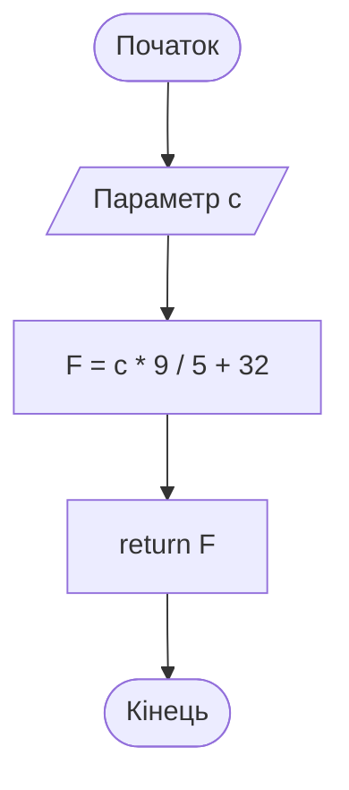
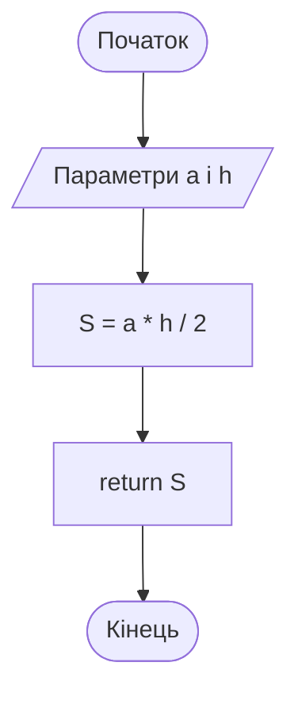
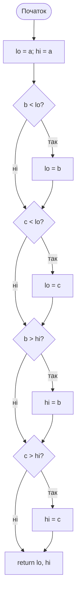
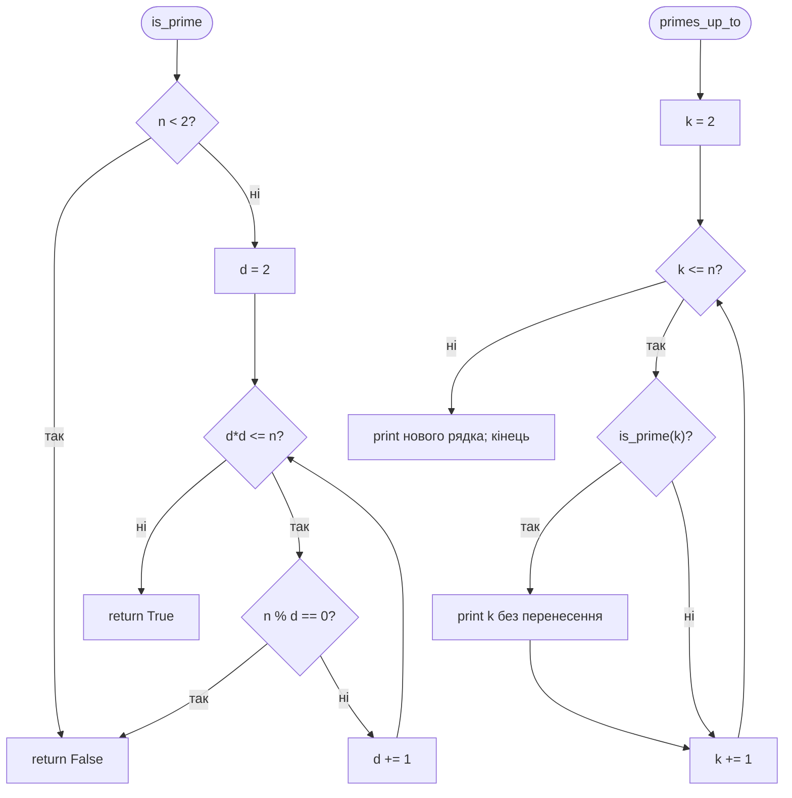
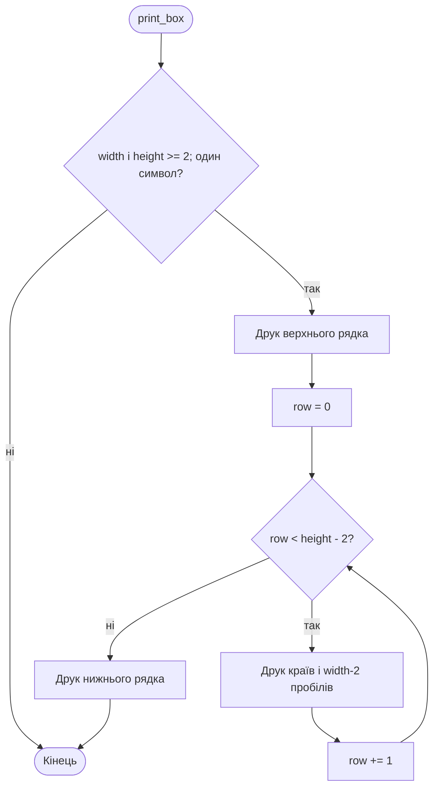
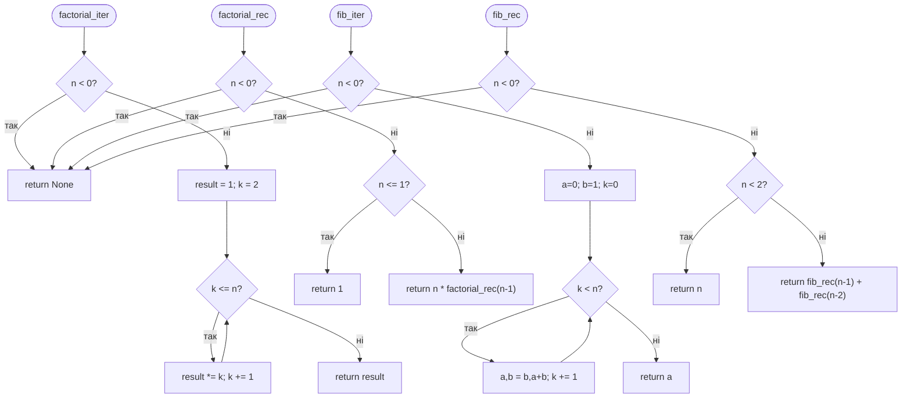
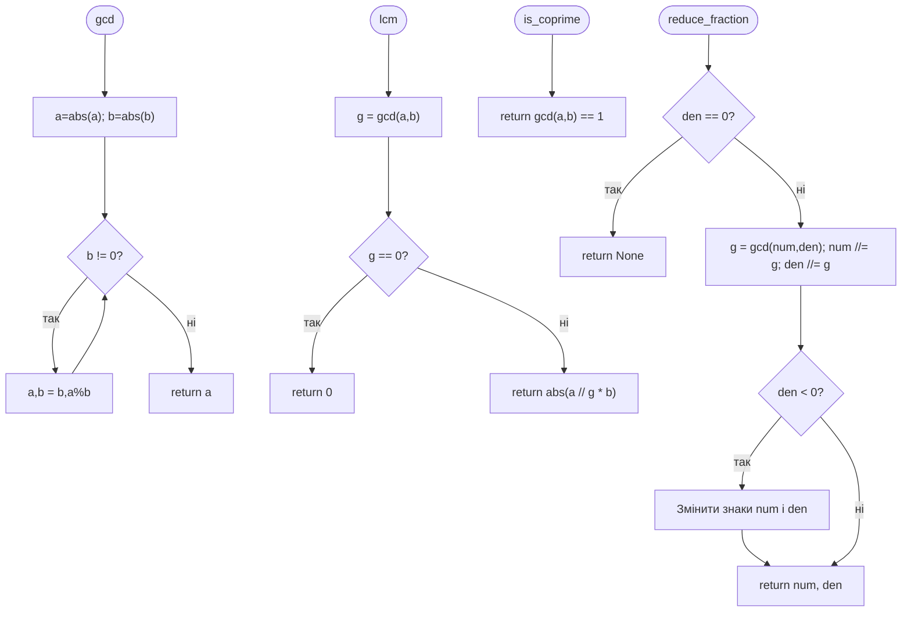
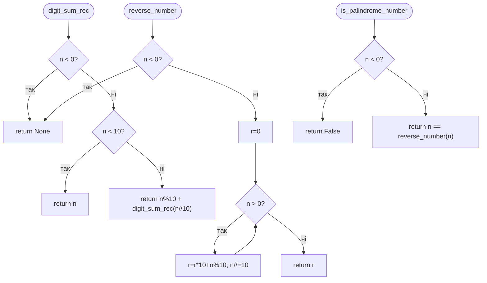
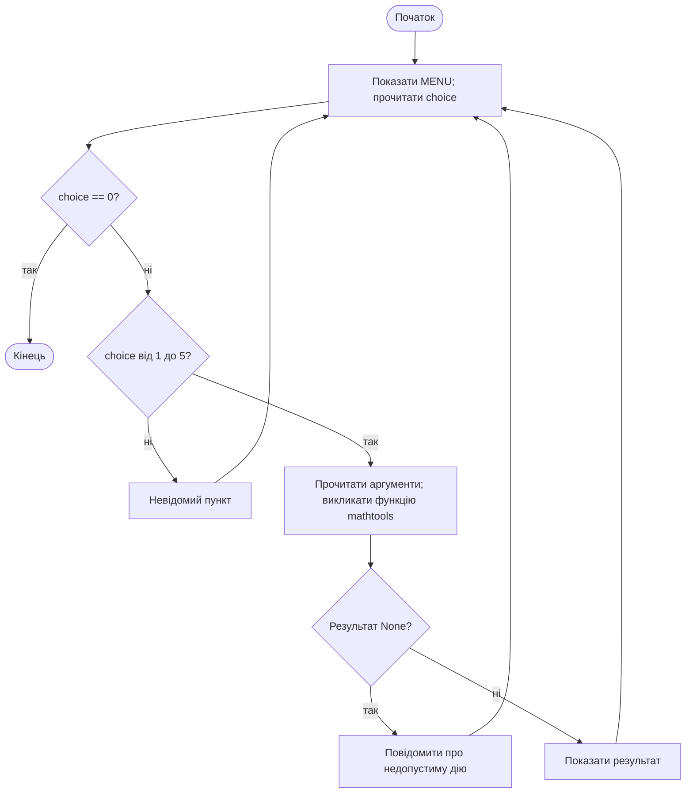

# Звіт з практичної роботи П3
## Функції та Git

ПІБ: Руслан Чухно  
Група: МІТ-1026а  
Дата: 09.11.2026  
Посилання: https://github.com/Rusik778/python-practice

## 1 Виконані рівні

- [x] Рівень 1 — задачі 1–5.
- [x] Рівень 2 — задачі 6–8.
- [x] Рівень 3 — задача 9.
- [x] Додаткові вправи — f_to_c, rectangle_area, ручний min_max, count_primes, height у рамці, power у меню.
- [x] Для кожної задачі наведено ідею, блок-схему, трасування і тести.
- [x] Git — щонайменше три змістовні коміти, README та .gitignore; файли опубліковано.

## 2 Перевірка та розв’язання

Виконано 117 перевірок викликів, процедур, сеансів меню та вимірювань швидкості. Окремо перевірено відсутність введення й виведення під час імпорту та повторне використання gcd, is_prime і reverse_number. Усі перевірки пройдено. У таблицях наведено фактичні результати виконання; для рядків виводу позначення \n означає перенесення рядка, пробіли збережено.

Вхідні дані відповідають умовам: цілі числа для числових алгоритмів, скінченні числа для вимірювань і ділення. Рамка має width>=2, height>=2 та один символ; за недопустимих параметрів процедура не друкує. Факторіал, Фібоначчі й обробка цифр для від’ємного аргументу повертають None, а перевірка паліндрому — False. Для gcd(0,0) та lcm(0,0) прийнято 0.

Відповідно до методички текст замість числа може викликати ValueError: обробка таких введень не входить до цієї роботи. Меню коректно обробляє невідомий номер пункту та ділення на нуль.

### Задача 1 Температура

Обчислити F=C*9/5+32 та повернути результат. Додано обернену f_to_c.

**Блок-схема**



**Трасування c_to_f(100)**

| Дія | Результат |
|---|---|
| 100 * 9 | 900 |
| 900 / 5 | 180.0 |
| 180.0 + 32 | 212.0 |
| return | 212.0 |

**Тести**

| Виклик або вхід | Очікуване | Отримане | Збіг |
|---|---|---|---|
| c_to_f(100) | 212.0 | 212.0 | так |
| c_to_f(-40) | -40.0 | -40.0 | так |
| c_to_f(0) | 32.0 | 32.0 | так |
| c_to_f(37) | 98.6 | 98.6 | так |
| f_to_c(77.0) | 25.0 | 25.0 | так |

### Задача 2 Площа трикутника

Повернути a*h/2 для невід’ємних довжин. Додаткова rectangle_area повертає a*b.

**Блок-схема**



**Трасування triangle_area(6, 4)**

| Дія | Результат |
|---|---|
| 6 * 4 | 24 |
| 24 / 2 | 12.0 |
| return | 12.0 |

**Тести**

| Виклик або вхід | Очікуване | Отримане | Збіг |
|---|---|---|---|
| triangle_area(6, 4) | 12.0 | 12.0 | так |
| triangle_area(10, 3) | 15.0 | 15.0 | так |
| triangle_area(7, 2) | 7.0 | 7.0 | так |
| triangle_area(0, 5) | 0.0 | 0.0 | так |
| rectangle_area(3, 5) | 15 | 15 | так |

### Задача 3 Мінімум і максимум

Зберігати lo і hi, починаючи з a; порівняти b і c та повернути пару. Реалізація без вбудованих min і max.

**Блок-схема**



**Трасування min_max(4, 9, 2)**

| Крок | lo | hi |
|---|---|---|
| Початок | 4 | 4 |
| Порівняння b=9 з lo | 4 | 4 |
| Порівняння c=2 з lo | 2 | 4 |
| Порівняння b=9 з hi | 2 | 9 |
| Порівняння c=2 з hi | 2 | 9 |

**Тести**

| Виклик або вхід | Очікуване | Отримане | Збіг |
|---|---|---|---|
| min_max(4, 9, 2) | (2, 9) | (2, 9) | так |
| min_max(-5, -2, -9) | (-9, -2) | (-9, -2) | так |
| min_max(3, 3, 3) | (3, 3) | (3, 3) | так |

### Задача 4 Прості числа

Перевіряти дільники, доки d*d<=n. Це точна цілочисельна перевірка до кореня. Процедура primes_up_to і додаткова count_primes використовують is_prime.

**Блок-схема**



**Трасування is_prime(9)**

| Крок | Значення | Дія |
|---|---|---|
| Перевірка n < 2 | False | d=2 |
| d=2; 2*2<=9 | 9 % 2 = 1 | d=3 |
| d=3; 3*3<=9 | 9 % 3 = 0 | return False |

**Тести**

| Виклик або вхід | Очікуване | Отримане | Збіг |
|---|---|---|---|
| is_prime(0) | False | False | так |
| is_prime(1) | False | False | так |
| is_prime(2) | True | True | так |
| is_prime(9) | False | False | так |
| is_prime(15) | False | False | так |
| is_prime(17) | True | True | так |
| is_prime(29) | True | True | так |
| is_prime(-1) | False | False | так |
| is_prime(49) | False | False | так |
| primes_up_to(30) | '2 3 5 7 11 13 17 19 23 29 \n' | '2 3 5 7 11 13 17 19 23 29 \n' | так |
| primes_up_to(2) | '2 \n' | '2 \n' | так |
| primes_up_to(1) | '\n' | '\n' | так |
| count_primes(20) | 8 | 8 | так |

### Задача 5 Рамка

Друкувати верх і низ, а між ними рядки з пробілами. Параметр height=3 додано після symbol, щоб виклики print_box(3,"#") залишалися правильними.

**Блок-схема**



**Трасування print_box(4)**

| Крок | Вивід |
|---|---|
| Верх | **** |
| Середина | *  * |
| Низ | **** |

**Тести**

| Виклик або вхід | Очікуване | Отримане | Збіг |
|---|---|---|---|
| print_box(4) | '****\n*  *\n****\n' | '****\n*  *\n****\n' | так |
| print_box(3, '#') | '###\n# #\n###\n' | '###\n# #\n###\n' | так |
| print_box(6) | '******\n*    *\n******\n' | '******\n*    *\n******\n' | так |
| print_box(2) | '**\n**\n**\n' | '**\n**\n**\n' | так |
| print_box(4, '#', 4) | '####\n#  #\n#  #\n####\n' | '####\n#  #\n#  #\n####\n' | так |

### Задача 6 Факторіал і Фібоначчі

Факторіал реалізувати циклом і рекурсією; Фібоначчі — одночасним оновленням пари та двома рекурсивними викликами.

**Блок-схема**



**Трасування factorial_rec(3)**

| Крок | Виклик або повернення |
|---|---|
| 1 | 3 * factorial_rec(2) |
| 2 | 2 * factorial_rec(1) |
| 3 | factorial_rec(1) → 1 |
| 4 | 2 * 1 → 2 |
| 5 | 3 * 2 → 6 |

**Тести**

| Виклик або вхід | Очікуване | Отримане | Збіг |
|---|---|---|---|
| factorial_iter(0) | 1 | 1 | так |
| factorial_rec(0) | 1 | 1 | так |
| factorial_iter(1) | 1 | 1 | так |
| factorial_rec(1) | 1 | 1 | так |
| factorial_iter(2) | 2 | 2 | так |
| factorial_rec(2) | 2 | 2 | так |
| factorial_iter(3) | 6 | 6 | так |
| factorial_rec(3) | 6 | 6 | так |
| factorial_iter(4) | 24 | 24 | так |
| factorial_rec(4) | 24 | 24 | так |
| factorial_iter(5) | 120 | 120 | так |
| factorial_rec(5) | 120 | 120 | так |
| factorial_iter(6) | 720 | 720 | так |
| factorial_rec(6) | 720 | 720 | так |
| factorial_iter(7) | 5040 | 5040 | так |
| factorial_rec(7) | 5040 | 5040 | так |
| factorial_iter(8) | 40320 | 40320 | так |
| factorial_rec(8) | 40320 | 40320 | так |
| factorial_iter(9) | 362880 | 362880 | так |
| factorial_rec(9) | 362880 | 362880 | так |
| factorial_iter(10) | 3628800 | 3628800 | так |
| factorial_rec(10) | 3628800 | 3628800 | так |
| fib_iter(0) | 0 | 0 | так |
| fib_rec(0) | 0 | 0 | так |
| fib_iter(1) | 1 | 1 | так |
| fib_rec(1) | 1 | 1 | так |
| fib_iter(7) | 13 | 13 | так |
| fib_rec(7) | 13 | 13 | так |
| fib_iter(10) | 55 | 55 | так |
| fib_rec(10) | 55 | 55 | так |
| fib_iter(20) | 6765 | 6765 | так |
| fib_rec(20) | 6765 | 6765 | так |
| factorial_iter(-1) | None | None | так |
| factorial_rec(-1) | None | None | так |
| fib_iter(-1) | None | None | так |
| fib_rec(-1) | None | None | так |

### Задача 7 НСД НСК і дроби

gcd виконує алгоритм Евкліда. lcm, is_coprime та reduce_fraction викликають gcd. Для дробу зі знаменником 0 повертається None.

**Блок-схема**



**Трасування gcd(12, 18)**

| Крок | a | b |
|---|---|---|
| 0 | 12 | 18 |
| 1 | 18 | 12 |
| 2 | 12 | 6 |
| 3 | 6 | 0 |

**Тести**

| Виклик або вхід | Очікуване | Отримане | Збіг |
|---|---|---|---|
| gcd(12, 18) | 6 | 6 | так |
| gcd(0, 18) | 18 | 18 | так |
| gcd(-12, 18) | 6 | 6 | так |
| gcd(0, 0) | 0 | 0 | так |
| lcm(12, 18) | 36 | 36 | так |
| lcm(4, 6) | 12 | 12 | так |
| lcm(0, 0) | 0 | 0 | так |
| is_coprime(7, 13) | True | True | так |
| is_coprime(8, 9) | True | True | так |
| is_coprime(12, 18) | False | False | так |
| is_coprime(8, 12) | False | False | так |
| reduce_fraction(12, 18) | (2, 3) | (2, 3) | так |
| reduce_fraction(10, 25) | (2, 5) | (2, 5) | так |
| reduce_fraction(7, 13) | (7, 13) | (7, 13) | так |
| reduce_fraction(0, 5) | (0, 1) | (0, 1) | так |
| reduce_fraction(12, -18) | (-2, 3) | (-2, 3) | так |
| reduce_fraction(1, 0) | None | None | так |

### Задача 8 Цифри числа

Суму цифр обчислювати рекурсією; розворот — накопиченням r*10+останньої цифри. Паліндром перевіряти через reverse_number.

**Блок-схема**



**Трасування reverse_number(5072)**

| Крок | n до | Цифра | r після | n після |
|---|---|---|---|---|
| 1 | 5072 | 2 | 2 | 507 |
| 2 | 507 | 7 | 27 | 50 |
| 3 | 50 | 0 | 270 | 5 |
| 4 | 5 | 5 | 2705 | 0 |

**Тести**

| Виклик або вхід | Очікуване | Отримане | Збіг |
|---|---|---|---|
| digit_sum_rec(7) | 7 | 7 | так |
| digit_sum_rec(10) | 1 | 1 | так |
| digit_sum_rec(50525) | 17 | 17 | так |
| digit_sum_rec(999) | 27 | 27 | так |
| digit_sum_rec(0) | 0 | 0 | так |
| reverse_number(1230) | 321 | 321 | так |
| reverse_number(5072) | 2705 | 2705 | так |
| reverse_number(0) | 0 | 0 | так |
| is_palindrome_number(12321) | True | True | так |
| is_palindrome_number(1221) | True | True | так |
| is_palindrome_number(7) | True | True | так |
| is_palindrome_number(1234) | False | False | так |
| is_palindrome_number(10) | False | False | так |
| is_palindrome_number(0) | True | True | так |
| is_palindrome_number(-121) | False | False | так |

### Задача 9 Бібліотека та меню

Функції з docstrings розміщено у mathtools.py; main.py імпортує їх та організовує меню. Додано пункт 5 для power.

**Блок-схема**



**Трасування Пункт 4 з аргументами 1 і 0**

| Крок | Стан |
|---|---|
| 1 | choice="4" |
| 2 | a=1.0; b=0.0 |
| 3 | divide(1.0,0.0) → None |
| 4 | Ділити на нуль не можна |
| 5 | Повернення до меню |

**Тести**

| Виклик або вхід | Очікуване | Отримане | Збіг |
|---|---|---|---|
| gcd(12, 18) | 6 | 6 | так |
| lcm(12, 18) | 36 | 36 | так |
| is_prime(17) | True | True | так |
| is_prime(9) | False | False | так |
| factorial(5) | 120 | 120 | так |
| factorial(0) | 1 | 1 | так |
| divide(7, 2) | 3.5 | 3.5 | так |
| divide(7, 0) | None | None | так |
| power(5) | 25 | 25 | так |
| power(2, 10) | 1024 | 1024 | так |
| power(0, -1) | None | None | так |
| Меню: 1, 12, 18, 2, 17, 3, 5, 4, 1, 0, 9, 0 | НСД = 6 НСК = 36 → Просте → Факторіал: 120 → Ділити на нуль не можна → Невідомий пункт меню → Роботу завершено | НСД = 6 НСК = 36 → Просте → Факторіал: 120 → Ділити на нуль не можна → Невідомий пункт меню → Роботу завершено | так |
| Меню: 2, 1, 0 | Не є простим або складеним → Роботу завершено | Не є простим або складеним → Роботу завершено | так |
| Меню: 4, 7, 2, 5, 2, 10, 0 | Частка: 3.5 → Степінь: 1024.0 → Роботу завершено | Частка: 3.5 → Степінь: 1024.0 → Роботу завершено | так |
| Меню: 3, -1, 0 | Число має бути невід’ємним → Роботу завершено | Число має бути невід’ємним → Роботу завершено | так |

## 3 Чому рекурсивна версія Фібоначчі повільніша

fib_rec(35) повторно обчислює ті самі значення у двох гілках рекурсії, тому кількість викликів зростає експоненційно. fib_iter(35) виконує 35 послідовних оновлень двох змінних без повторного розв’язання підзадач.

Виміряно реальний час одного запуску кожного варіанта; значення залежать від комп’ютера та навантаження.

| Виклик | Результат | Час у секундах |
|---|---|---|
| fib_rec(30) | 832040 | 0.26666540 |
| fib_rec(35) | 9227465 | 2.83066250 |
| fib_iter(35) | 9227465 | 0.00000500 |

## 4 Звіт про Git

Репозиторій: https://github.com/Rusik778/python-practice

Кількість комітів після додавання цього звіту: **5**.

Журнал перед фінальним комітом документації, у порядку git log --oneline:

```text
482fad7 Додано бібліотеку mathtools з docstrings та меню
8342842 Додано рекурсію, НСД, скорочення дробів і цифри числа
bc71298 Додано прості числа, рамку та додаткові вправи рівня 1
243622f Додано задачі 1–3: температура, площа, мінімум і максимум
```

П’ятим комітом додано README, блок-схеми, таблиці тестів і цей звіт. Його ідентифікатор можна переглянути на GitHub або командою git log --oneline.

- README.md є: так; містить ім’я, групу, список файлів та запуск.
- .gitignore є: так, у корені й папці mathtools_project.
- У відстежуваних файлах немає __pycache__ і .venv.
- Результат завантаження перевіряється на сторінці репозиторію та повторним отриманням файлів.

## 5 Труднощі

Основні місця, де легко помилитися: базовий випадок рекурсії, нульовий знаменник і розміщення return True після перевірки всіх дільників. Для них додано граничні тести; у алгоритмі Фібоначчі використано одночасне присвоєння, щоб не втрачати старі значення.

## 6 Самооцінка

Орієнтовна самооцінка — 100/100 за повноту виконання трьох рівнів, тестів, схем і Git. Остаточну оцінку визначає викладач, зокрема за поясненням функцій під час захисту.

## Приклад рамки

```text
******
*    *
******
```

## Матеріали

[Практична робота П3 — методичні вказівки, чек-лист і форма звіту](https://drive.google.com/file/d/18_CUi43JWCnuoDbEt7LLO1DsA-z4urXz/view).
